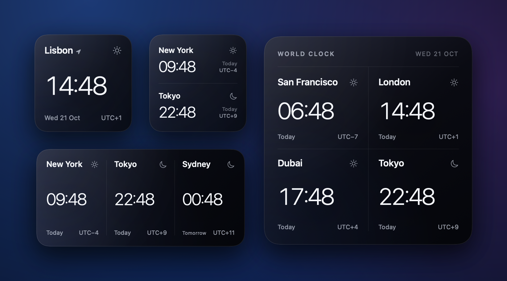
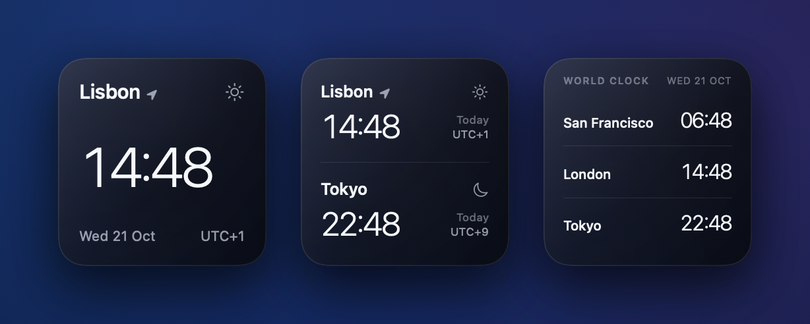
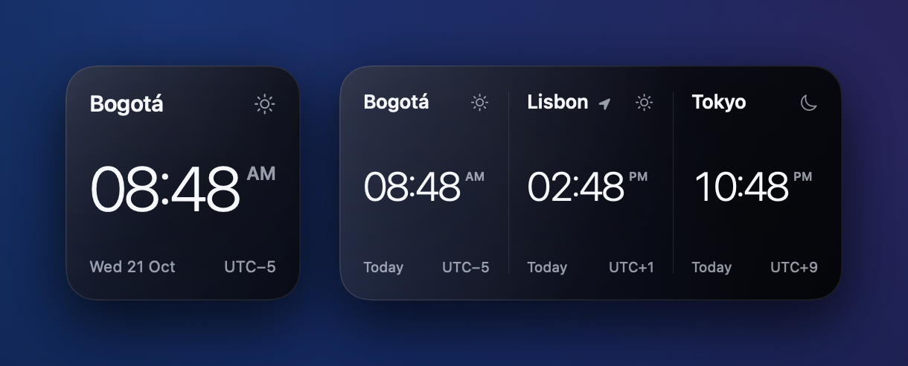
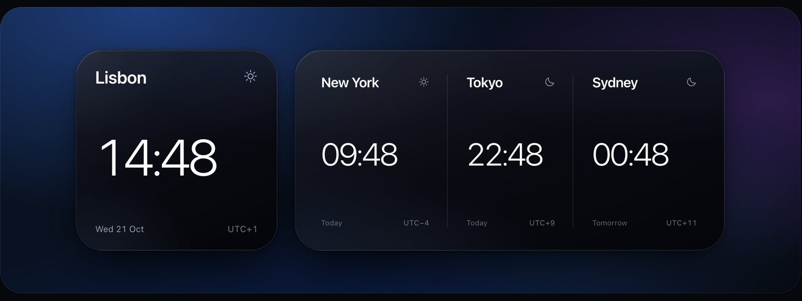
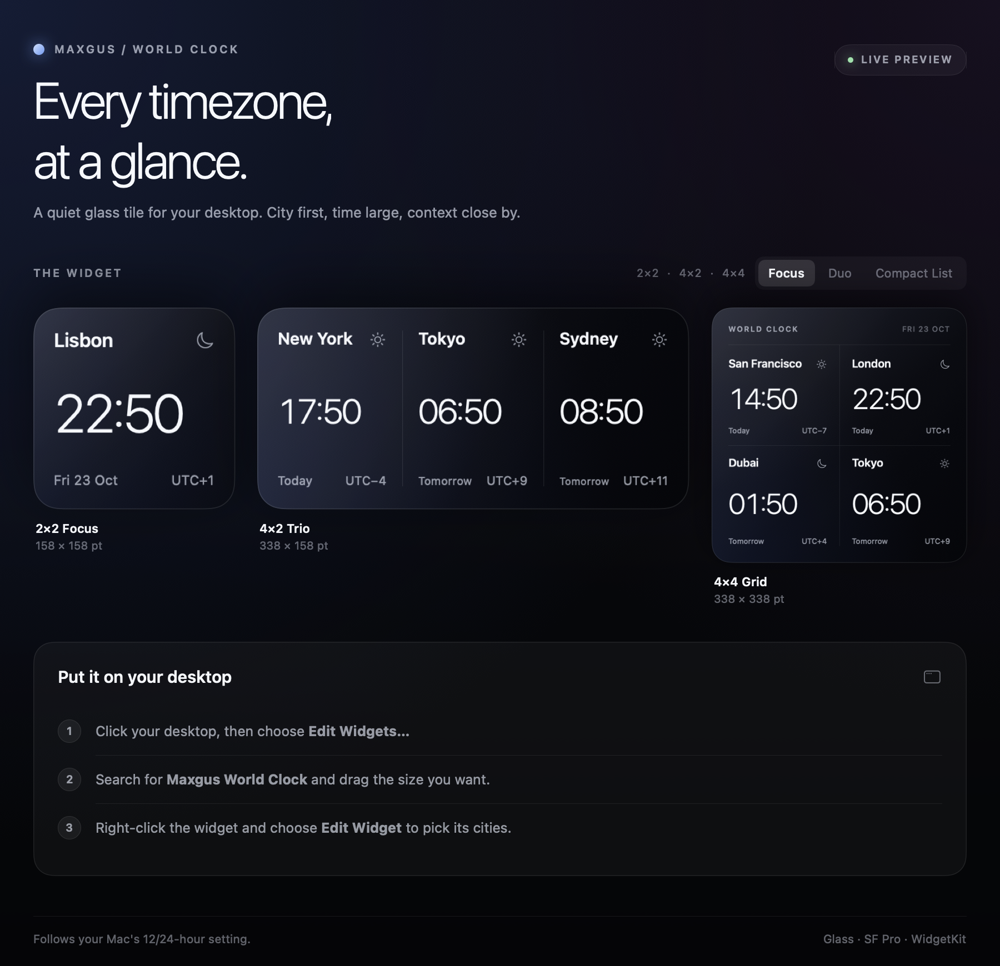

<div align="center">



# Maxgus World Clock

### Every timezone, at a glance.

A quiet glass world clock for the macOS desktop.<br>
City first, time large, context close by — built to sit beside Calendar and Weather without competing with them.


[Highlights](#-highlights) · [The widgets](#-the-widgets) · [Install](#-install) · [Choosing cities](#-choosing-cities) · [How it works](#-how-it-works) · [Design](#-design) · [Build & test](#-build--test)

</div>

---

## ✦ Highlights

- **Three sizes, five layouts.** A big single clock, two or three cities on a 2×2, three columns on a 4×2, a four-city grid on a 4×4.
- **Context, not clutter.** Every city shows *Today*, *Tomorrow* or *Yesterday* relative to your Mac, its UTC offset (half-hour zones included), and a sun or moon for day and night.
- **Minute-perfect.** Timelines are aligned to the minute, so the time, the day label and the offset all flip exactly when they should.
- **Follows your Mac.** 12- or 24-hour time comes from your system setting. In 12-hour mode, AM/PM becomes a small raised marker instead of competing with the numerals.
- **Home marker.** A tiny location arrow marks the city in your current time zone.
- **Names that fit together.** When a city name is too long, every name in that widget steps down to the same smaller size rather than each column shrinking on its own.
- **Edit Widget shows only what matters.** A Focus widget asks for one city; a 4×4 asks for four.
- **No developer account needed.** The ad-hoc build is fully configurable — see [why that took some care](#-how-it-works).

## ◐ The widgets

| Size | Layouts | Cities | Starts with |
| --- | --- | --- | --- |
| **2×2** · 158 × 158 pt | **Focus** | 1 | Lisbon |
| | **Duo** | 2 | Lisbon, Tokyo |
| | **Compact List** | 3 | San Francisco, London, Tokyo |
| **4×2** · 338 × 158 pt | **Trio** | 3 | New York, Tokyo, Sydney |
| **4×4** · 338 × 338 pt | **Grid** | 4 | San Francisco, London, Dubai, Tokyo |

<p align="center">
  
</p>

<p align="center">
  
  <br><sub>12-hour mode, with the home marker on Lisbon.</sub>
</p>

## ⇣ Install

You'll need **macOS 14 Sonoma or later** and **Xcode 16 or later** to build.

```sh
git clone https://github.com/alejandro-llanes/maxgus-world-clock.git
cd maxgus-world-clock
./Scripts/build-dmg.sh
```

Then:

1. Open `dist/Maxgus World Clock.dmg` and drag **Maxgus World Clock** onto **Applications**.
2. Open the app once from Applications.
3. Click the desktop, choose **Edit Widgets…**, search for **Maxgus World Clock**, and drag a size onto the desktop.
4. Right-click the placed widget and choose **Edit Widget** to pick its cities.

<details>
<summary><b>Copying the app to another Mac?</b></summary>

<br>

The build is ad-hoc signed and not notarized. If macOS refuses to open it, right-click the app and choose **Open**, or clear the quarantine flag:

```sh
xattr -dr com.apple.quarantine "/Applications/Maxgus World Clock.app"
```

To sign with a Developer ID and notarize instead:

```sh
CODESIGN_IDENTITY="Developer ID Application: Your Name (TEAMID)" \
NOTARY_PROFILE="your-notarytool-profile" \
  ./Scripts/build-dmg.sh
```

</details>

## ⌖ Choosing cities

Right-click a widget → **Edit Widget**. Each placement keeps its own cities, and any slot you leave empty uses the defaults above, so a freshly placed widget already looks composed.

The picker offers 45 cities, grouped by region:

| Region | Cities |
| --- | --- |
| **Africa** | Cairo, Cape Town, Lagos, Nairobi |
| **Americas** | Bogotá, Buenos Aires, Chicago, Denver, Lima, Los Angeles, Mexico City, Miami, New York, Rio de Janeiro, San Francisco, Santiago, São Paulo, Toronto, Vancouver |
| **Asia & Pacific** | Auckland, Bangkok, Delhi, Dubai, Honolulu, Hong Kong, Jakarta, Manila, Mumbai, Seoul, Shanghai, Singapore, Sydney, Tokyo |
| **Europe** | Amsterdam, Berlin, Istanbul, Lisbon, London, Madrid, Moscow, Paris, Reykjavík, Rome, Stockholm, Zürich |

To add a city, add one line to [`CityCatalog.swift`](Shared/CityCatalog.swift).

## ⚙ How it works

- **Minute-aligned timelines.** The `AppIntentTimelineProvider` emits 61 entries starting on the current minute and asks for a new timeline when they run out, about once an hour.
- **One model for every tile.** [`CityTime`](Shared/CityTime.swift) turns a city and a moment into everything a tile shows: the time, AM/PM, date, relative day, UTC offset, day or night, and whether it's your home zone.
- **One design system, two targets.** The widget and the host app render the same SwiftUI views from [`WidgetViews.swift`](Shared/WidgetViews.swift), so the app's live previews are the real widgets.
- **Settings are plain strings — on purpose.** macOS decodes custom App Intents types (entities and enums) through `linkd`, and `linkd` rejects apps without a Team ID. In an ad-hoc build, those values arrive empty and every widget silently falls back to its defaults. Storing city names and the style as plain strings keeps decoding inside the widget, so Edit Widget works without a developer account. The trade-off is a menu of built-in cities rather than a searchable list.
- **Built by Xcode, end to end.** [`build-dmg.sh`](Scripts/build-dmg.sh) runs `xcodebuild`, so the App Intents metadata behind Edit Widget is always generated from the code. It also unregisters the build-folder copy, so macOS only ever runs the widget from `/Applications`.

## ◇ Design

The look started as an interactive design study in [`design/index.html`](design/index.html) — open it in a browser to flip between wallpapers and 12/24-hour time. The SwiftUI views carry its tokens over directly:

| Token | Value |
| --- | --- |
| **Type** | SF Pro, light numerals with tight tracking; tabular figures so minutes never shift the layout |
| **Ink** | `#F6F8FC` primary · 62% for cities and dates · 40% for offsets and meta |
| **Hairlines** | 10% white, used for every divider |
| **Corners** | Continuous, 13% of the tile's short side; 7.5% on 4×4 |
| **Glass** | Layered dark gradients with a soft blue bloom, over the system material |

<p align="center">
  
</p>

<details>
<summary><b>The host app</b></summary>

<br>

Opening the app shows live previews of every size and the steps to put a widget on your desktop.



</details>

## ⌘ Build & test

| Command | What it does |
| --- | --- |
| `./Scripts/run-tests.sh` | Runs the `WorldClockTests` unit tests (same as ⌘U in Xcode) |
| `./Scripts/build-dmg.sh` | Builds the universal Release app and `dist/Maxgus World Clock.dmg` |

To work in Xcode, open `MaxgusWorldClock.xcodeproj`, choose the **MaxgusWorldClock** scheme and press ⌘R. With no team selected, Xcode signs to run locally.

The tests compile the shared model code without a host app, so running them never launches or registers the widget.

<details>
<summary><b>Project structure</b></summary>

<br>

```
MaxgusWorldClock.xcodeproj
MaxgusWorldClock/          Host app: onboarding and live widget previews
WorldClockWidget/          WidgetKit extension and Edit Widget configuration
Shared/
  CityEntity.swift         City model and small-widget styles
  CityCatalog.swift        The 45 cities, per-size defaults, fallback resolution
  CityTime.swift           Time, date, offset, home marker and relative-day logic
  WidgetViews.swift        Glass tile and all five widget layouts
Scripts/
  build-dmg.sh             Universal build, DMG packaging, optional notarization
  run-tests.sh             Runs the WorldClockTests target
  INSTALL.txt              Installed as "Read Me.txt" in the DMG
Tests/
  WorldClockTests.swift    Catalog, offsets, day boundaries, slot resolution
design/                    Interactive design study and preview
docs/screenshots/          Renders used in this README
```

</details>

<details>
<summary><b>Troubleshooting</b></summary>

<br>

**The widget isn't in the gallery.** Open the app once, then check that macOS registered the extension:

```sh
pluginkit -m -v | grep maxgus
```

It should list `com.maxgus.worldclock.widget` from `/Applications`. If it's missing, register it and reopen the app:

```sh
pluginkit -a "/Applications/Maxgus World Clock.app/Contents/PlugIns/WorldClockWidget.appex"
open -a "Maxgus World Clock"
```

**A widget ignores the cities you picked.** Make sure only one copy is registered — the `pluginkit` command above should print a single line. Copies left in build folders can be removed with `pluginkit -r <path to WorldClockWidget.appex>`.

</details>

---

<div align="center">
<sub>Made for the macOS desktop · Glass · SF Pro · WidgetKit</sub>
</div>
