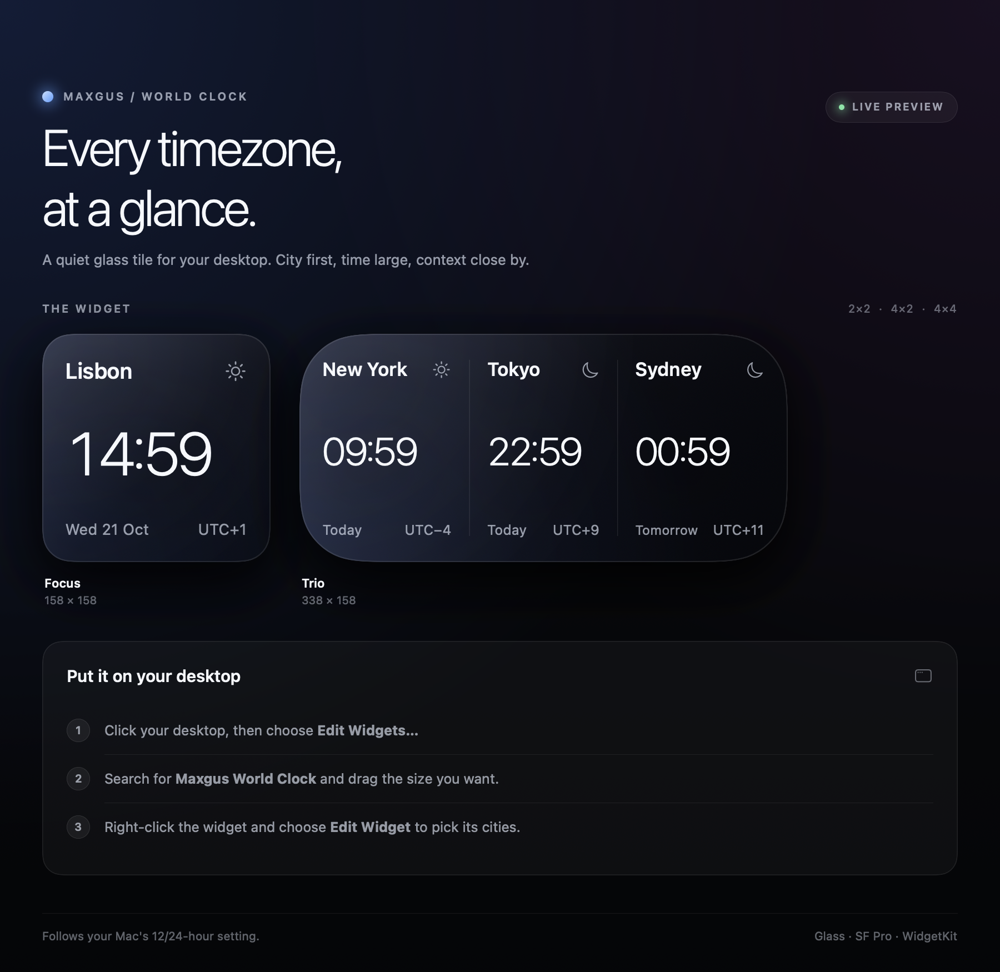
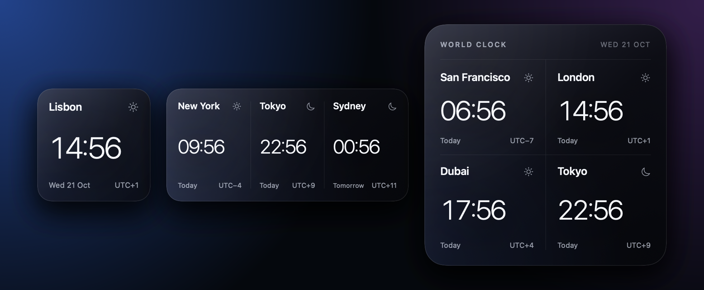

# Maxgus — World Clock

A macOS desktop widget for keeping an eye on the time in cities around the world. Built with SwiftUI and WidgetKit in the same visual family as the Calendar and Weather widgets that inspired it: dark glass, SF Pro, oversized numerals, almost no chrome.





*Actual SwiftUI renders at 158 / 338 pt, not mockups.*

## Install the prebuilt app

`dist/Maxgus World Clock.dmg` is a ready-to-install universal build (Apple silicon and Intel).

1. Open the DMG.
2. Drag **Maxgus World Clock** onto **Applications**.
3. Open the app once from Applications.
4. Click the desktop, choose **Edit Widgets…**, search for **Maxgus World Clock**, and drag a size onto the desktop.
5. To choose cities: right-click the placed widget → **Edit Widget**.

Widget sizes:

| Size | Layout | Cities |
| --- | --- | --- |
| 2×2 | Focus, Duo, or Compact List | 1 to 3 cities |
| 4×2 | Trio | Up to three cities |
| 4×4 | Grid | Up to four cities |

The build is ad-hoc signed. If macOS blocks it on another Mac, right-click the app → **Open**, or remove the download quarantine flag:

```sh
xattr -dr com.apple.quarantine "/Applications/Maxgus World Clock.app"
```

If the widget doesn't show up in the gallery, launch the app once, then check registration:

```sh
pluginkit -m -v | grep maxgus
```

If it is missing, register it manually and reopen the app:

```sh
pluginkit -a "/Applications/Maxgus World Clock.app/Contents/PlugIns/WorldClockWidget.appex"
open -a "Maxgus World Clock"
```

The same instructions are included as `Read Me.txt` inside the DMG.

## Requirements

- macOS 14 Sonoma or later.
- To install the prebuilt DMG: no Xcode required.
- To build from source: Xcode 15 or later. The standalone packaging script needs only the Command Line Tools (`swiftc`, `lipo`, `codesign`, `iconutil`, `hdiutil`).

## Build and test without Xcode

To run the automated test suite:

```sh
./Scripts/run-tests.sh
```

To build the universal installer app and DMG:

```sh
./Scripts/build-dmg.sh
```

The script:

- compiles the host app and widget extension with `swiftc` for `arm64` and `x86_64`, then combines them with `lipo`;
- builds the embedded `WorldClockWidget.appex` with the `NSExtensionMain` entry point WidgetKit expects;
- creates the app icon, `Info.plist` files, sandbox entitlements, and signatures;
- emits both `dist/Maxgus World Clock.app` and `dist/Maxgus World Clock.dmg`, plus a SHA-256 checksum.

Signing is ad-hoc by default. To sign and notarize with a Developer ID:

```sh
CODESIGN_IDENTITY="Developer ID Application: Your Name (TEAMID)" \
NOTARY_PROFILE="AC_PASSWORD" \
  ./Scripts/build-dmg.sh
```

## Build and run in Xcode

1. Open `MaxgusWorldClock.xcodeproj`.
2. Select the **MaxgusWorldClock** target → **Signing & Capabilities** → choose your Team.
   Do the same for the **WorldClockWidget** target. If you don't have a developer account, choose **Sign to Run Locally**.
3. Choose the **MaxgusWorldClock** scheme and press **Run** (⌘R).
4. Click the desktop, choose **Edit Widgets…**, search for **Maxgus World Clock**, and drag a size onto the desktop.
5. To choose cities after placing a widget: right-click it → **Edit Widget**.

## Configuration

Each widget placement keeps its own city configuration:

| Family | Cities used |
| --- | --- |
| Small (2×2) Focus | First city only |
| Small (2×2) Duo | First two cities |
| Small (2×2) Compact List | First three cities |
| Medium (4×2) | First three cities |
| Large (4×4) | All four cities |

Empty slots fall back to a curated default set (or the user's custom default roster configured inside the host app), so a newly placed widget already looks composed. Search works across the built-in catalog of ~40 cities and accepts any IANA time zone identifier (e.g. `America/Bogota`, `Europe/Warsaw`).

## How it works

- **Minute-perfect timelines.** `AppIntentTimelineProvider` emits 61 entries aligned to the minute and reloads at the end of the hour. The clock, day label, and UTC offset flip together exactly when they should.
- **Context, not clutter.** `CityTime` derives the localized time, date, "Tomorrow"/"Yesterday", UTC offset, and day/night state for each city. Day changes and half-hour offsets are handled.
- **System-aware formatting.** The widget follows the Mac's 12/24-hour preference. In 12-hour mode, AM/PM becomes a small raised marker instead of competing with the numerals.
- **Multiple small-widget styles.** People can pick between **Focus** (1 city), **Duo** (2 cities), and **Compact List** (3 cities) right from the widget configuration intent.
- **In-app default roster management.** The host app includes live previews for all sizes (2×2, 4×2, and 4×4) and allows managing default roster cities with live search across all time zones.
- **One design system, two targets.** The widget and the host app share the same SwiftUI views (`FocusClockView`, `DuoClockView`, `CompactListClockView`, `TrioClockView`, `GridClockView`) and glass background.
- **Home city badge.** A subtle location marker marks the city matching your current local time zone.
- **Resilient window placement.** If macOS restores the host window from a display that is no longer attached, the app centers it on the main screen instead of opening off-screen.

## Project structure

```
MaxgusWorldClock.xcodeproj
MaxgusWorldClock/          Host app: onboarding, roster manager, live widget previews
WorldClockWidget/          WidgetKit extension and configuration intent
Shared/
  CityEntity.swift         AppEntity, SmallWidgetStyle, and entity query
  CityCatalog.swift        City catalog, defaults, IANA search, fallback resolution, RosterStore
  CityTime.swift           Time, date, offset, home badge, and day-relation logic
  WidgetViews.swift        Glass tile, home badge, and all five widget layouts
Scripts/
  build-dmg.sh             Xcode-free universal build + DMG packaging + notarization support
  run-tests.sh             Command-line test runner for unit test suite
  generate-appintents-metadata.sh  AppIntents metadata generator
  INSTALL.txt              Text installed as Read Me.txt in the DMG
Tests/
  WorldClockTests.swift    Unit tests for catalog search, offsets, day boundaries, deduplication
design/                    Design study (HTML) and rendered previews
dist/                      Built app, DMG, and checksum (generated)
```

## Verification

Run the test suite:

```sh
./Scripts/run-tests.sh
```

Both targets type-check against the installed macOS SDK with a macOS 14 deployment target. The packaged extension is registered with the system: `pluginkit` lists `com.maxgus.worldclock.widget`, and `chronod` discovers the extension when the app launches.
